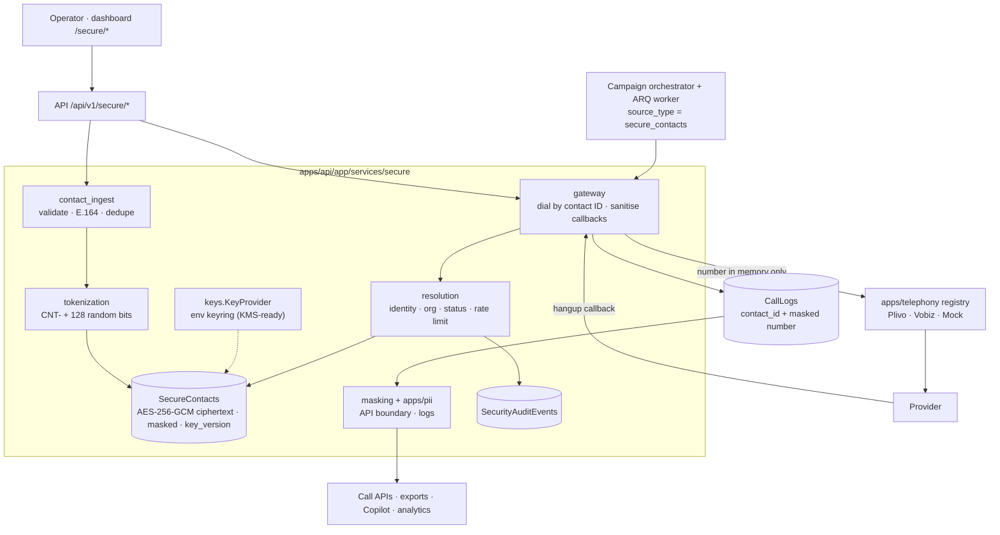
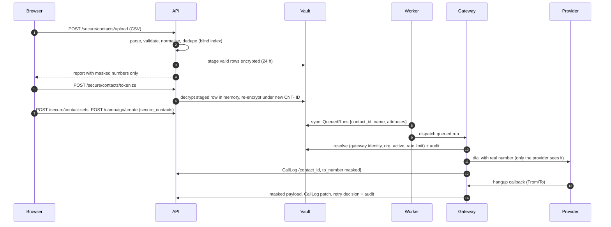

# VoicEra Secure

A contact-privacy layer for VoicEra. Contact phone numbers are validated and encrypted on upload, replaced everywhere else by opaque contact IDs, and decrypted only inside the secure telephony gateway for an authorised dial. Every access is audited.

This is a proof of concept built inside the existing VoicEra codebase. The [status table](#implemented-vs-planned) separates what is implemented and tested from what is designed but not built.

- [Architecture](#architecture)
- [Data flow: one campaign contact](#data-flow-one-campaign-contact)
- [Security design decisions](#security-design-decisions)
- [Local setup](#local-setup)
- [Environment variables](#environment-variables)
- [Running the tests](#running-the-tests)
- [Demonstration walkthrough](#demonstration-walkthrough)
- [Implemented vs planned](#implemented-vs-planned)
- [Known limitations](#known-limitations)
- [Production-readiness checklist](#production-readiness-checklist)
- [Integration notes for VoicEra maintainers](#integration-notes-for-voicera-maintainers)
- [API reference](api.md)
- [Adopters, per-adopter keys and RBAC](multitenancy-rbac.md): multi-tenancy, roles, platform admins, transparent hashing of numbers in the normal campaign upload and outbound API

## Architecture



| Component | Location | Role |
|---|---|---|
| Shared redaction | `apps/pii/` | Standard-library masking and log redaction used by the API, worker, orchestrator, runtime and telephony clients |
| Key management | `services/secure/keys.py` | `KeyProvider` interface; `EnvKeyProvider` reads a versioned keyring and a separate blind-index key |
| Encryption | `services/secure/crypto.py` | AES-256-GCM with per-value nonce and org/contact-bound associated data; keyed HMAC blind index |
| Phone parsing | `services/secure/phone.py` | libphonenumber validation and E.164 normalisation; errors never echo input |
| Tokenisation | `services/secure/tokenization.py` | `CNT-` + 32 hex characters from `secrets` |
| Vault storage | `services/secure/vault_repository.py` | `SecureContacts`, staging, batches, contact sets, measured counters |
| Ingest | `services/secure/contact_ingest.py` | CSV validation, duplicate detection, encrypted staging, tokenisation |
| Service identity | `services/secure/service_identity.py` | In-process gateway identity; HTTP service credentials with scopes |
| Resolution | `services/secure/resolution.py` | The only decrypt path: checks, rate limit, audit, masked wrapper |
| Gateway | `services/secure/gateway.py` | Dial by contact ID through the existing outbound service; sanitise callbacks |
| Campaign source | `services/campaign/sources/secure_contacts.py` | Queued runs carry `contact_id`, never numbers |
| Masking | `services/secure/masking.py` | Masks call logs at the API boundary (including legacy plaintext rows) |
| Audit | `services/secure/security_audit.py` | Security events with correlation ID, source IP and suspicious-pattern detection |
| Read models | `services/secure/insights.py` | Overview metrics, health checks, campaign protection, settings, rotation, retention |
| Mock provider | `apps/telephony/providers/mock/` | Opt-in provider for demos and tests; never registered unless enabled |
| Dashboard | `frontend/src/components/secure/`, `frontend/src/app/(app)/secure/` | Seven pages under the "Secure" sidebar group |

## Data flow: one campaign contact



What changed relative to the original flow (see the Phase 1 assessment): the raw CSV is no longer stored for vault campaigns; queue entries, retries and redials hold contact IDs; call logs store the masked number; custom variables are scrubbed; provider log lines and error bodies are redacted; call APIs, campaign runs, the campaign report, and Copilot tools return masked numbers; the dashboard's CSV export, CSV preview, Copilot card and test-call toast no longer show raw numbers.

## Security design decisions

**Encryption.** AES-256-GCM (authenticated encryption) from `cryptography`. Each value gets a fresh 96-bit random nonce. The associated data is `voicera-secure:v1:{org_id}:{contact_id}:{field}`, so ciphertext copied onto another record or into another organisation fails authentication rather than decrypting. Stored form: `{alg, key_version, nonce, ciphertext}`.

**Keys.** Keys come from `SECURE_VAULT_KEYS` as versioned entries (`v1:<key>,v2:<key>`), never from source code. Missing, malformed or short keys raise `VaultKeyError`; there is no fallback cipher and no plaintext mode. `KeyProvider` is the seam for a managed KMS: a production provider would wrap a per-record data key with a KMS master key (envelope encryption) without changing any caller.

**Rotation.** New records use `SECURE_VAULT_ACTIVE_KEY_VERSION`. Older versions stay in the keyring as decrypt-only. *Settings → Run rotation* re-encrypts every record not on the active version and writes a `key.rotation` event. A version can be removed once its record count reaches zero; records under a removed version become unreadable (fail closed), which the health check reports.

**Tokens.** `CNT-` plus 128 bits from the OS CSPRNG. Nothing is derived from the number, so a token cannot be reversed. A unique index enforces uniqueness; the insert retries on the (theoretical) collision.

**Why not plain hashing.** The phone-number space is small (India has about 10^10 mobile numbers), so an unkeyed hash can be brute-forced in minutes. Duplicate detection instead uses HMAC-SHA256 under a separate key (`SECURE_VAULT_INDEX_KEY`) over `org_id` and the E.164 number. It supports equality lookups only, is scoped per organisation, and is never returned by any API. It is deterministic by design, so anyone holding the index key and database could confirm whether a specific number is present; keep the key in the same trust tier as the data keys.

**Resolution.** `resolution.resolve_contact` is the only function that decrypts a stored number. Checks run in order: service identity and scope, contact exists *in the caller's organisation* (a contact in another organisation returns the same "not found" as a missing one, so IDs cannot be probed), contact active, per-service rate limit, ciphertext authentication. Every outcome is audited. The result is a `ResolvedNumber` whose `str` and `repr` are masked, so it cannot leak through logging or string formatting. User sessions can never resolve: `POST /secure/contacts/{id}/resolve` accepts only service credentials from `SECURE_SERVICE_CREDENTIALS` (separate from `INTERNAL_API_KEY`, compared in constant time).

**The provider must see the number.** The gateway hands the decrypted number to the existing vendor-agnostic `initiate_outbound_call`, which passes it to Plivo, Vobiz or the mock. Nothing else stores it: the call log gets the masked value and `contact_id`, the number goes out of scope after the dial request, and provider log lines are masked at source.

**Callbacks.** `apps.telephony.sanitize_webhook_payload` masks `From`, `To` and similar fields before a callback is logged or applied. Outbound calls are correlated by `call_id`, so VoicEra never needs the raw number back. Inbound caller numbers are stored masked.

**Masking at the boundary.** New call logs store contact numbers masked. `services/secure/masking.py` also masks every call-log response at read time, so rows written before VoicEra Secure are covered. Only the contact side is masked; the organisation's own caller ID stays visible, as the dashboard already assumed. CSV exports neutralise spreadsheet formula injection.

**Logs.** `apps.pii.log_redaction` installs a filter on every stdlib handler (API, ARQ worker, orchestrator) and a loguru patcher (runtime). Known raw log sites were also fixed at source, so redaction is a second line of defence, not the only one. The redactor deliberately over-matches: any run of 10–15 bare digits is masked.

**Audit.** `SecurityAuditEvents` is separate from the existing `AuditLog`, whose contract and Copilot tool are unchanged. Events carry event ID, organisation, actor (type, ID, role), action, contact ID, outcome, reason, correlation ID (`X-Request-ID`, accepted or minted by middleware and echoed on the response), source IP and scrubbed metadata. Keys such as `ciphertext`, `phone`, `secret` and `token` are dropped from metadata. Five denials by one actor within five minutes raise one `access.suspicious` event.

**Synthetic data safety.** Uploads marked synthetic can only be dialled through the mock provider; the gateway refuses (and audits) any attempt to dial them through Plivo or Vobiz.

## Local setup

### Option A: no Docker (demo launcher)

Requires Python 3.11 and Node 20+. Everything runs in memory: data disappears when the launcher stops.

```bash
python3.11 -m venv .venv
```

```bash
.venv/bin/pip install -r apps/api/requirements.txt -r apps/api/requirements-test.txt
```

```bash
PYTHONPATH="$PWD:$PWD/apps/api" .venv/bin/python scripts/secure/run_local_demo.py
```

The launcher starts the real API on port 8000 with mongomock, a fakeredis server on port 6390 shared by the ARQ worker and campaign orchestrator, and the mock telephony provider. It then signs up a demo admin, stores mock telephony credentials, creates a telephony agent and attaches a caller ID, and prints the sign-in details. Set `DEMO_ADMIN_EMAIL` and `DEMO_ADMIN_PASSWORD` to choose them.

In a second terminal, start the dashboard (it proxies `/api/v1` to port 8000):

```bash
npm --prefix frontend run dev
```

### Option A2: persistent backend without Docker (MongoDB on disk)

Same processes as option A, but accounts, organisations, roles, contacts and audit events are stored in a real MongoDB and survive restarts. MongoDB Community (official macOS arm64 build) lives in `~/.voicera/mongodb`, its data in `~/.voicera/data/db`. The database name and port come from `.env`, and `SECURE_VAULT_KEYS` must be set there so stored numbers stay readable across restarts.

```bash
scripts/secure/local-backend.sh start
```

`stop`, `status` and `logs` work the same way. The dashboard dev server (`npm --prefix frontend run dev`) proxies `/api/v1` to port 8000. The job queue is in-process (transient), MinIO and the voice runtime are not included, and the mock telephony provider is enabled (`run_local_backend.py --no-mock` to turn it off). Platform admins are set with `PLATFORM_ADMIN_EMAILS` in `.env`.

### Option B: full stack (Docker)

`./scripts/start-application-services.sh` now also generates `SECURE_VAULT_KEYS` and `SECURE_VAULT_INDEX_KEY` in `.env` when they are missing or still the `.env.example` placeholder. To use the mock provider with the full stack, set `TELEPHONY_MOCK_ENABLED=true` in `.env` before starting.

## Environment variables

| Variable | Default | Purpose |
|---|---|---|
| `SECURE_VAULT_KEYS` | none (vault disabled) | Versioned AES-256 keys, `v1:<urlsafe-b64 32 bytes>,v2:…` |
| `SECURE_VAULT_ACTIVE_KEY_VERSION` | highest version | Version used for new encryptions |
| `SECURE_VAULT_INDEX_KEY` | none | Optional, no longer required: hash keys are now per adopter (see [multitenancy-rbac.md](multitenancy-rbac.md)) |
| `PLATFORM_ADMIN_EMAILS` | empty | Comma-separated VoicEra platform admins (manage adopters; no access to adopter data) |
| `SECURE_SERVICE_CREDENTIALS` | empty | External resolvers, `service_id\|scope+scope\|secret`, secret ≥ 32 chars. Scopes: `contacts:resolve:dial`, `contacts:resolve` |
| `SECURE_DEFAULT_REGION` | `IN` | Region for numbers written without `+` |
| `SECURE_RESOLVE_RATE_LIMIT_PER_MINUTE` | 600 | Per service identity, per organisation |
| `SECURE_DENIAL_ALERT_THRESHOLD` | 5 | Denials in 5 minutes that raise `access.suspicious` |
| `SECURE_CONTACT_RETENTION_DAYS` | 365 | Default retention for inactive contacts (overridable per organisation) |
| `SECURE_ENFORCE_VAULT_CAMPAIGNS` | false | Reject plain CSV campaigns platform-wide |
| `TELEPHONY_MOCK_ENABLED` | false | Register the mock provider. Demo and test only |
| `TELEPHONY_MOCK_CALLBACK_DELAY_SECONDS` | 2 | Delay before the mock delivers its hangup callback |
| `TELEPHONY_MOCK_CALLBACK_MODE` | `in_process` | `http` sends mock callbacks to the runtime's `/answer` instead |

Generate a key:

```bash
python3 -c "import base64,secrets;print(base64.urlsafe_b64encode(secrets.token_bytes(32)).decode())"
```

## Running the tests

Run each suite in its own `pytest` invocation, with the repository root on `PYTHONPATH` (see `docs/developer/guides/testing.md`). The API suite now needs `apps/api/requirements-test.txt` (mongomock, fakeredis, lupa); mongomock was already used by `test_audit_log.py` but was not listed anywhere.

```bash
PYTHONPATH="$PWD" .venv/bin/python -m pytest apps/api/tests -q
```

```bash
PYTHONPATH="$PWD" .venv/bin/python -m pytest apps/telephony/tests apps/runtime/tests -q
```

VoicEra Secure tests:

| File | Covers |
|---|---|
| `apps/api/tests/test_secure_crypto.py` | Round trip, unique nonces, org/contact binding, tamper detection, fail-closed keys, malformed keyrings, rotation, retired keys, keyed blind index, phone normalisation, errors without input echo |
| `apps/api/tests/test_pii_redaction.py` | Masking, redaction of numbers/emails without touching IDs and timestamps, stdlib filter (args, exceptions, uvicorn access logs), loguru patcher |
| `apps/api/tests/test_secure_vault.py` | Valid/invalid CSV, duplicates in file and against the vault, org-scoped duplicates, unique opaque tokens, encryption at rest, safe views, authorised / unauthorised / cross-org / deleted / inactive resolution, tamper, rate limit, 30 concurrent resolutions, suspicious-access alert, service credentials |
| `apps/api/tests/test_secure_gateway.py` | Mock provider opt-in, deterministic outcomes, callback sanitisation, gateway dial with no raw numbers in DB/audit/logs, synthetic-on-real-provider refusal, deleted/foreign contacts, **100-contact bulk campaign with retries through the real dispatcher and orchestrator**, API journey with no numbers in any response, resolve denials over HTTP, role checks, campaign from contact set, foreign CSV source rejection, vault-only policy, gateway route, key rotation endpoint, masking of legacy plaintext in existing call/campaign/Copilot endpoints |
| `apps/telephony/tests/test_mock_provider.py` | Mock registration, provider-style callbacks, sanitiser |
| `apps/runtime/tests/test_log_redaction.py` | Runtime loguru redaction |

## Demonstration walkthrough

Uses `frontend/public/samples/secure_contacts_sample_100.csv` (100 synthetic rows: 93 valid, 4 duplicates, 3 invalid), downloadable from the Contacts page. Regenerate it with `scripts/secure/generate_synthetic_contacts.py`.

1. **Overview.** Sign in and open *Secure → Overview*. With an empty vault it shows an empty state and the health checks.
2. **Upload.** *Contacts*: leave "Synthetic demo data" on and choose the sample CSV.
3. **Validation.** The report shows 100 rows, 93 valid, 3 invalid, 4 duplicates. *Issues only* lists each problem row with a masked number and the reason ("Same number as row 7", "Phone number has the wrong length").
4. **Tokenise.** Click *Tokenise 93 valid contacts*. The result lists names, `CNT-` IDs and masked numbers.
5. **Vault.** *Contact Vault* shows only opaque IDs and masked numbers. Click a contact: the panel shows encryption metadata and its security events, never the number.
6. **Encrypted storage.** The panel states the algorithm and key version. Behind it, the stored record holds only `{alg, key_version, nonce, ciphertext}`; `test_numbers_are_encrypted_at_rest` asserts no plaintext number exists anywhere in the collection.
7. **Campaign.** *Campaign Security → New secure campaign*: name it, choose the demo agent, keep "Every active contact", create. The table shows it as *Contact IDs* with 0 plaintext queue entries.
8. **Gateway resolution.** *Secure Gateway*: the resolution table fills with *Granted* rows from `secure-telephony-gateway` for each campaign dial.
9. **Mock call.** Choose the agent and a contact and click *Call by contact ID*. The result shows the destination as VoicEra stores it (masked). Numbers ending 7 are busy first and answered on retry; 8 no answer; 9 failed.
10. **Denied access.** Under *Test access controls*, choose a contact and try *Resolve with my session* (refused, 403) and *Resolve with an invalid service key* (refused, 401).
11. **Audit.** *Audit Logs*: filter Outcome = Denied to see both attempts with actor, contact ID, reason, correlation ID and source IP. Open any event for its full metadata.
12. **No exposure.** *History* shows masked contact numbers; its CSV export, *Contact Vault → Export (masked)*, and the campaign report all contain masked numbers only. Run a scan over the API log and every endpoint, as was done during verification: 0 of the 93 synthetic numbers appeared in 807 log lines or in any response.

## Implemented vs planned

| Capability | Status |
|---|---|
| CSV validation, E.164 normalisation, duplicate detection | Implemented, tested |
| AES-256-GCM vault with versioned keys and rotation | Implemented, tested |
| Opaque contact IDs, org-scoped storage, erasure, retention purge | Implemented, tested |
| Resolution service with scoped service identities, rate limiting, audit | Implemented, tested |
| Secure gateway, vault campaign source, bulk dispatch and retries by contact ID | Implemented, tested |
| Mock telephony provider | Implemented, tested |
| Callback sanitisation (outbound via gateway; inbound stored masked) | Implemented, tested |
| API-boundary masking of existing call, campaign and Copilot endpoints | Implemented, tested |
| Log redaction (API, worker, orchestrator, runtime) | Implemented, tested |
| Security audit with correlation IDs and suspicious-pattern alerts | Implemented, tested |
| Dashboard: seven Secure pages, existing-page leak fixes | Implemented, verified in the browser |
| Managed KMS key provider | Planned (interface in place) |
| Provider webhook signature validation; authenticated media WebSocket | Planned |
| Redaction of spoken PII in transcripts and recordings | Planned |
| Migration of legacy plaintext (old CSVs in MinIO, old QueuedRuns) | Planned; legacy rows are masked on read and counted by the health check |
| Distributed resolution rate limit (Redis) | Planned; per process today |
| Per-adopter data and hash keys under a master key; adopter rotation, suspension, offboarding | Implemented, tested |
| Transparent hashing + encryption in the normal campaign CSV upload and outbound API | Implemented, tested |
| RBAC: fixed roles, central route policy (fail closed), membership-based role checks | Implemented, tested, verified in the browser |
| Platform admin console (adopters, platform audit) | Implemented, tested, verified in the browser |
| Legacy plaintext migration script | Implemented, tested |
| Custom roles per adopter; per-adopter API keys | Not built |

## Known limitations

- The resolution rate limiter is per process. Several API or worker replicas each get the full limit.
- The blind index is deterministic (required for duplicate detection); see the design note above.
- Legacy plain-CSV campaigns still store the uploaded CSV in MinIO and phone numbers in QueuedRuns. The vault-only policy stops new ones; existing data is not migrated.
- The agent prompt variable `{{called_number}}` now holds the masked number. Prompts that read a number aloud will read the masked value.
- Inbound caller numbers are stored masked, not vaulted, so they cannot be called back by contact ID.
- Log redaction masks string arguments and the format string; integers passed to `%d` are not rewritten. No current log site does this with a phone number.
- The loguru patcher does not rewrite rendered tracebacks; call sites must not put numbers in exception messages (the known ones were fixed).
- In development, React runs effects twice, so opening a contact records two `contact.view` events. Production builds record one.
- The audit page's "Export this page" builds the CSV in the browser from the loaded page and is not itself audited.
- `CORS allow_origins="*"` and the JWT in `localStorage` are unchanged.

## Production-readiness checklist

- [ ] Generate unique `SECURE_VAULT_KEYS` and `SECURE_VAULT_INDEX_KEY` per environment (the health check fails on values from `.env.example`).
- [ ] Move keys to a managed KMS by implementing a `KeyProvider`.
- [ ] Set `TELEPHONY_MOCK_ENABLED=false`.
- [ ] Turn on the vault-only campaign policy (`SECURE_ENFORCE_VAULT_CAMPAIGNS=true` or per organisation in Settings).
- [ ] Migrate or delete legacy campaign CSVs and plaintext QueuedRuns, then confirm the "Legacy plaintext numbers at rest" check passes.
- [ ] Validate Plivo / Vobiz webhook signatures and authenticate the runtime's media WebSocket.
- [ ] Move the resolution rate limiter to Redis.
- [ ] Give external resolvers their own `SECURE_SERVICE_CREDENTIALS` entries with the narrowest scope; rotate their secrets.
- [ ] Restrict CORS to the dashboard origin.
- [ ] Ship `SecurityAuditEvents` to an append-only store or SIEM and alert on `access.suspicious`.
- [ ] Define retention for transcripts and recordings and add transcript redaction.
- [ ] Run a penetration test against `/api/v1/secure/*`.

## Integration notes for VoicEra maintainers

- **Behaviour changes in existing endpoints.** `GET /calls/*`, `GET /campaign/{id}/runs`, `GET /campaign/{id}/report`, Copilot `list_calls` / `get_call`, and `POST /calls/outbound` / `/calls/inbound` responses return the contact number masked. Three assertions in two existing test files were updated to expect masked values (`test_inbound_calls.py`, `test_outbound_calls.py`).
- **Campaign creation.** CSV `source_id` must belong to the caller's organisation (`campaigns/{org_id}/…`); a foreign key now returns 404. `GET /campaign/{id}/source-download-url` is admin-only, audited, and expires in 5 minutes.
- **`INTERNAL_API_KEY`** is compared in constant time.
- **New collections** (indexes created at startup): `SecureContacts`, `SecureContactStaging`, `SecureContactBatches`, `SecureContactSets`, `SecureMetrics`, `SecureOrgSettings`, `SecurityAuditEvents`.
- **Docker images** now copy `apps/pii` (API and runtime Dockerfiles).
- **Dependencies.** `phonenumbers` added to `apps/api/requirements.txt`; `apps/api/requirements-test.txt` added for test-only packages.
- **Unchanged.** Pipecat pipeline, frame serializers, answer XML, Plivo and Vobiz clients (except their log lines), provider registry behaviour when the mock is disabled.
