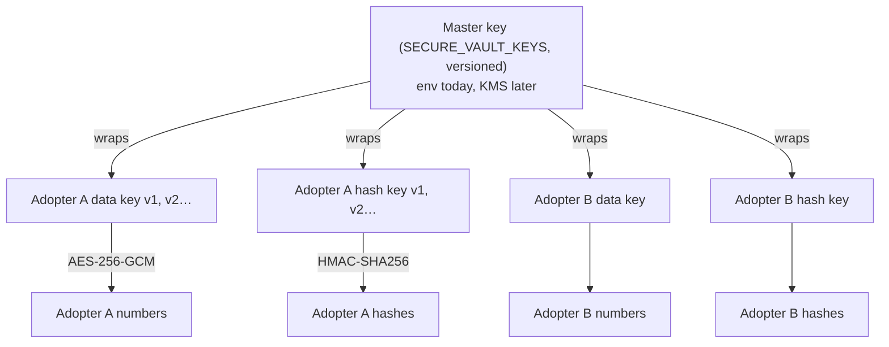

# Adopters, per-adopter keys and RBAC

How VoicEra Secure supports many adopters (10–20 or more) on one platform: each adopter's numbers are hashed and encrypted under that adopter's own keys, people get one role per adopter, and VoicEra operators manage adopters without seeing their data.

- [Model](#model)
- [How numbers are handled](#how-numbers-are-handled)
- [Key hierarchy](#key-hierarchy)
- [Roles and permissions](#roles-and-permissions)
- [Enforcement](#enforcement)
- [Platform admins and the adopter lifecycle](#platform-admins-and-the-adopter-lifecycle)
- [Sign-in and sessions](#sign-in-and-sessions)
- [Migrating existing data](#migrating-existing-data)
- [Configuration](#configuration)
- [Tests](#tests)
- [Limits of this build](#limits-of-this-build)

## Model

| Concept | In VoicEra | Notes |
|---|---|---|
| Adopter (tenant) | An organisation (`Organizations.org_id`) | Status `active`, `suspended` or `offboarded` |
| Person in an adopter | `Memberships {email, org_id, role}` | One role per adopter; a person can belong to several adopters |
| VoicEra operator | Platform admin | `PLATFORM_ADMIN_EMAILS` or `Users.platform_role = "platform_admin"` |
| Adopter keys | `SecureTenantKeys` | Own data key and hash key per adopter, wrapped by the master key |

All adopter data was already scoped by `org_id`. This build adds per-adopter cryptographic separation, central permission checks on every route, adopter status enforcement, and the platform tier.

## How numbers are handled

Adopters keep using VoicEra as before and send plain numbers:

- **Campaign CSV upload** (`POST /campaign/upload`, the normal Campaigns page). The CSV is validated in memory. Each number is normalised to E.164, **hashed** with the adopter's HMAC key, and **encrypted** with the adopter's AES-256-GCM key. A number the adopter already sent before (same hash) reuses its existing contact. The file is never written to object storage. The response's `source_id` is a contact set and `source_type` is `secure_contacts`; the dashboard passes both to `POST /campaign/create`, and older clients that still send `source_type: "csv"` with that ID are accepted. Each row's other columns are kept as the agent's prompt variables, with phone-like values masked.
- **Outbound call API** (`POST /calls/outbound`). The number is hashed and encrypted the same way and the call log stores its contact ID and masked form. The plain number goes only to the dial request.
- **Dialling.** Queued campaign calls, retries and redials carry the contact ID. The secure gateway decrypts the number in memory for one dial and hands it to Plivo, Vobiz or any registered provider. The provider is the only party that receives it.

The hash is what makes "hash and store" useful: VoicEra can tell that two uploads contain the same number, link calls to contacts and de-duplicate, without decrypting anything. Encryption is kept alongside the hash because a hash cannot be turned back into a number, so retries, redials and scheduled campaigns could not dial otherwise.

## Key hierarchy



- Adopter keys are 256-bit random keys, generated when the organisation is created (or on first use if no master key was configured then).
- They are stored only wrapped: AES-256-GCM under the master key, with associated data `adopter + key version + key type`. A wrapped key copied into another adopter's record fails to unwrap.
- Ciphertext is bound to adopter, contact ID and field, so it can't be moved between records or adopters either.
- The same number produces a different hash for every adopter.

| Operation | Who | Effect |
|---|---|---|
| Rotate an adopter's keys | Adopter owner/admin (Secure → Settings) or platform admin | New key version; every record of that adopter is re-encrypted and re-hashed; old versions are destroyed once unused. Other adopters untouched. |
| Rotate the master key | Platform: add `v2` to `SECURE_VAULT_KEYS`, make it active, restart, then *Re-wrap master key* | Re-wraps every adopter's keys; no data is re-encrypted. Remove the old master version afterwards. |
| Suspend an adopter | Platform admin | Adopter keys become unavailable, so nothing can be decrypted or dialled. |
| Offboard (revoke) | Platform admin, adopter must be suspended, exact name typed | Wrapped keys destroyed (crypto-shredding): every stored number of that adopter is permanently unreadable; contacts erased. Irreversible. |

## Roles and permissions

Four fixed roles per adopter: Super admin, Admin, Campaign manager and Viewer (stored ids `super_admin`, `admin`, `campaign_manager`, `member`; the display names changed from Owner/Member without a data migration). **Only the Super admin handles phone numbers**: uploading contact lists, creating and deleting campaigns, dialling a typed number and erasing contacts. Everyone else does their job without touching numbers, and every role, the Super admin included, sees numbers masked; no role can see a full number in VoicEra.

Why the exclusivity: numbers are citizens' personal data, so the fewer people handle them the fewer ways they can leak or be misused; one accountable person (the adopter's data fiduciary under the DPDP Act) decides who is called and for what; a compromised Admin or Campaign manager account yields no numbers; and staff who leave never had them.

| Role | For |
|---|---|
| Super admin | Controls the organisation and is the only person who brings numbers in. |
| Admin | Runs the platform (people, agents, numbers, integrations) and campaigns, but never handles numbers. |
| Campaign manager | Runs campaigns day to day (start, pause, redial) and reviews calls and results. |
| Viewer | View only: agents, campaigns, call history (outcome only) and dashboards. |

| What | Super admin | Admin | Campaign manager | Viewer |
|---|:-:|:-:|:-:|:-:|
| **Build** | | | | |
| Use the Agent Builder copilot (`copilot:use`) | ✓ | ✓ |  |  |
| View agents (`agents:read`) | ✓ | ✓ | ✓ | ✓ |
| Create and edit agents (`agents:write`) | ✓ | ✓ |  |  |
| Delete agents (`agents:delete`) | ✓ | ✓ |  |  |
| Test an agent in the browser (`calls:test`) | ✓ | ✓ | ✓ |  |
| Call a typed phone number (`calls:dial`) | ✓ |  |  |  |
| View caller IDs (`numbers:read`) | ✓ | ✓ | ✓ | ✓ |
| Attach and detach caller IDs (`numbers:write`) | ✓ | ✓ |  |  |
| View knowledge base (`knowledge:read`) | ✓ | ✓ | ✓ | ✓ |
| Upload and delete knowledge documents (`knowledge:write`) | ✓ | ✓ |  |  |
| **Campaigns and contacts** | | | | |
| Upload, rename and delete contact lists (`contacts:write`) | ✓ |  |  |  |
| See contact lists (masked) (`lists:read`) | ✓ | ✓ | ✓ |  |
| Create, edit and delete campaigns (`campaigns:write`) | ✓ |  |  |  |
| Start, pause, resume and redial campaigns (`campaigns:run`) | ✓ | ✓ | ✓ |  |
| View campaigns and progress (`campaigns:read`) | ✓ | ✓ | ✓ | ✓ |
| Download campaign reports (masked) (`campaigns:export`) | ✓ | ✓ | ✓ |  |
| **Results** | | | | |
| Call history (masked numbers) (`calls:read`) | ✓ | ✓ | ✓ | ✓ |
| Recordings, transcripts and full call analysis (`recordings:read`) | ✓ | ✓ | ✓ |  |
| Analytics and campaign results (`analytics:read`) | ✓ | ✓ | ✓ | ✓ |
| Telemetry (latency and AI usage) (`telemetry:read`) | ✓ | ✓ | ✓ |  |
| **Security and data protection** | | | | |
| Data-protection overview and settings (`security:read`) | ✓ | ✓ |  |  |
| Browse the contact vault (masked) (`contacts:read`) | ✓ | ✓ |  |  |
| Erase a contact (`contacts:delete`) | ✓ |  |  |  |
| Export contacts (masked) (`contacts:export`) | ✓ |  |  |  |
| Secure gateway dial log (`gateway:read`) | ✓ | ✓ | ✓ |  |
| Audit logs (`audit:read`) | ✓ | ✓ |  |  |
| Change security settings and rotate keys (`security:write`) | ✓ |  |  |  |
| **Workspace** | | | | |
| See who is in the organisation (`members:read`) | ✓ | ✓ | ✓ | ✓ |
| Invite members, change roles, remove members (`members:write`) | ✓ | ✓ |  |  |
| View integrations (`integrations:read`) | ✓ | ✓ |  |  |
| Change provider keys (`integrations:write`) | ✓ | ✓ |  |  |
| Delete the organisation (`org:delete`) | ✓ |  |  |  |

The source of truth is `apps/api/app/rbac.py` (`ROLES`, `PERMISSION_MATRIX`); `GET /api/v1/rbac/roles` returns it and the dashboard shows it under Workspace → Roles & Permissions. `calls:update` is used only by the voice runtime's service token. The retired roles *Agent builder*, *Analyst* and *Auditor* act as *Viewer*, and memberships holding them are moved to `member` at API startup (`rbac.migrate_legacy_roles`).

**Role assignment rules.** The Super admin can give anyone any role except Super admin. Admins can assign Campaign manager and Viewer, can't create Admins and can't change or remove the Super admin or another Admin. Nobody changes their own role or the Super admin's. Roles are changed in one place: the Role column of the members table on the Members page (an inline dropdown that offers only the roles the caller may grant; it applies immediately). The Roles & Permissions page is read-only. Changes are recorded in the activity log and the security audit.

**Invitations.** People join only through an invitation: the Super admin or an Admin enters the email and role (`POST /members/invitations`), gets a one-time link (`/signup?invite=…`) and can have it emailed (needs `MAILTRAP_API_TOKEN`; otherwise the link is copied and sent by hand). The link works once, only for that email, and expires after 7 days; only its SHA-256 is stored. Pending invitations can be withdrawn. The old open link that used the organisation ID as the code (`/signup?org=…`) no longer works, because anyone who learnt a six-character ID could join.

## Contact lists, call analysis and campaign results

* **Contact lists** (`/api/v1/contact-lists`, page *Contact Lists*): the Super admin uploads a named CSV or Excel (.xlsx) file. Numbers are hashed and encrypted on arrival under the adopter's keys, the file is never stored, and invalid or repeated rows are skipped and reported by row number. Campaigns are created by picking a list (`source_type: secure_contacts`), the same way an agent is picked. A list used by an unfinished campaign can't be deleted; deleting a list leaves its contacts in the vault.
* **Call analysis** (`app/services/call_analysis.py`): every finished call gets an outcome (interested, not interested, call back, wrong person, no answer, unclear), sentiment, a short summary and feedback for the agent. Answered calls are analysed from their transcript with the adopter's own OpenAI key when one is configured (`engine: llm`), otherwise with built-in rules (`engine: rules`); the result always says which. Transcripts are redacted before storage or analysis. Calls through the mock provider get a clearly labelled synthetic transcript (`transcript_source: synthetic_mock`) so the flow can be tried without a carrier. Viewers see only the outcome.
* **Post-campaign analytics** (`GET /campaign/{id}/analytics`): calls made, answer rate, average duration, interest rate, outcome and sentiment breakdowns, and the most common agent-feedback themes, with the number of synthetic transcripts called out.

## Enforcement

`app.rbac.authorize` is attached to every router in `main.py`. For each request it:

1. Looks up the matched route in `ROUTE_POLICY` (method + path template). **A route with no entry is refused**, and a test asserts every route has one.
2. `public` routes (login, signup, password reset) and `service` routes (bot token, internal callbacks, resolve) pass through to their own authentication.
3. Verifies the bearer token.
4. For platform routes, requires platform admin.
5. For adopter routes: refuses if the adopter is suspended or offboarded; reads the caller's **current role from `Memberships`** rather than trusting the role inside the token; refuses if the caller is no longer a member; checks the permission.
6. Records every denial as an `auth.failed` security event (`action: permission_denied`).

Role and adopter-status lookups are cached for 15 seconds per process, so a removed member or a suspension takes effect within that window everywhere (immediately in the process that made the change). The runtime's bot token is accepted with its admin role for the adopter in the token.

The dashboard calls `GET /api/v1/rbac/me` and hides navigation and actions the role can't use. This is a convenience only; the API enforces everything.

## Platform admins and the adopter lifecycle

Platform admins see **Platform → Adopters** and **Platform audit** in the dashboard.

- **Create adopter**: name, owner email and first password (omit if the owner already has an account). Creates the organisation, its keys and the owner membership.
- **Adopter list and details**: status, owners, member counts by role, agents, campaigns, calls, protected-contact counts, key versions and recent security events. Never contacts, numbers or call content.
- **Suspend / reactivate**: suspension blocks the adopter's users and API calls, pauses running campaigns and makes its keys unavailable.
- **Rotate adopter key**, **offboard (destroy keys)** and **re-wrap master key**, as described above.
- **Platform audit**: security events across adopters, filterable by adopter and outcome.

A platform admin has no access to an adopter's data unless they are also a member of that adopter, in which case their role there applies like anyone else's.

## Sign-in and sessions

| Situation | What happens |
|---|---|
| Email typed in any case or with spaces | Accepted: emails are trimmed and lower-cased everywhere (sign-in, sign-up, invite, join, password reset). Accounts created earlier with mixed case still sign in. |
| Wrong password or unknown email | 401 with the same message for both ("Incorrect email or password."), so accounts can't be discovered by probing |
| 5 failures for one email, or 20 from one IP, within 15 minutes | 429 "Too many failed sign-in attempts. Try again in N minutes." with `Retry-After`; even the right password is refused until the window passes. Failures and lockouts are recorded as security events against the user's adopter. A successful sign-in clears the count. |
| Member of several adopters | Signs in to the last-used adopter if it's active, otherwise the oldest active one; switch from the profile menu |
| Their adopter is suspended | If they belong to another active adopter they land there; otherwise 403 "Your organisation is suspended. Contact the VoicEra platform team." |
| Switching to a suspended adopter | Refused with a message in the profile menu |
| Adopter suspended while signed in | A banner appears (permissions refresh on tab focus and every minute) and every adopter request returns a clear 403 |
| Role changed or removed while signed in | Applied by the API within 15 s; the dashboard updates on the next refresh |
| Joining through an invitation | Needs a valid one-time invitation for that email; creates the account (or verifies the existing one, without duplicates) with the invited role; refused for a suspended adopter or an expired, used or withdrawn link |
| Expired or tampered token | 401; the dashboard clears the session and returns to sign-in |
| Invalid email address | 422 "Enter a valid email address (for example name@organisation.gov.in)." |

Not in this build: server-side session revocation on sign-out (tokens are stateless and expire after `ACCESS_TOKEN_EXPIRE_MINUTES`, 120 by default), multi-factor sign-in, and SSO.

## Migrating existing data

Numbers stored before this change (old campaign queues, call logs) are covered by a one-off migration:

```bash
PYTHONPATH="$PWD:$PWD/apps/api" python scripts/secure/migrate_legacy_numbers.py
```

That is a dry run that reports counts. Add `--apply` to hash and encrypt queued numbers (runs keep their contact ID and dial normally), mask call logs and link outbound calls to contacts. Add `--delete-source-files` to also delete the legacy campaign CSVs from object storage (irreversible; review the dry-run list first).

## Configuration

| Variable | Purpose |
|---|---|
| `SECURE_VAULT_KEYS`, `SECURE_VAULT_ACTIVE_KEY_VERSION` | Master key ring (wraps every adopter's keys). Required. |
| `SECURE_VAULT_INDEX_KEY` | No longer required: hash keys are per adopter. Accepted if set. |
| `PLATFORM_ADMIN_EMAILS` | Comma-separated platform admin emails. Alternatively set `platform_role: "platform_admin"` on a user document. |

`./scripts/start-application-services.sh` generates the master key in `.env` if it's missing.

## Tests

| File | Covers |
|---|---|
| `apps/api/tests/test_secure_crypto.py` | Separate keys per adopter, wrapped storage, wrapped key can't move between adopters, adopter rotation leaves others untouched, destroyed versions fail closed, master re-wrap and retirement, suspend/reactivate, revoke |
| `apps/api/tests/test_rbac_tenancy.py` | Every route has a policy; role catalogue invariants; 4 roles × 25 endpoints permission matrix through the real app; retired roles act as Viewer and are migrated; denials audited; role read from membership not token; removed member loses access; token for another adopter refused; cross-adopter isolation; `/rbac/me`; bot token; role-change rules; platform-only routes; platform admin sees no tenant data; create adopter with own keys and working owner login; suspension blocks users, keys and campaigns but not other adopters; per-adopter rotation; offboarding preconditions and crypto-shredding; platform audit; response models accept every role; sign-in for each role |
| `apps/api/tests/test_login_flows.py` | Email case and whitespace, identical error for wrong password and unknown email, lockout and audit, per-email lockout, no memberships, suspended adopter fallback and refusal, organisation switching incl. suspended target, sign-up lower-casing and reuse of existing accounts, invite with role, no duplicate accounts, expired and tampered tokens, role changes reaching live sessions, invitation join with its role, one-time and email-bound links, invitation rules and withdrawal, email-not-configured note, joining a suspended adopter, plain invalid-email message |
| `apps/api/tests/test_contact_lists_and_analysis.py` | Super-admin-only list upload/rename/delete, CSV and Excel parsing (long numbers, skipped rows), plain errors for bad files, unique names, delete blocked by a running campaign, adopter isolation; rules-engine outcomes, transcript redaction, mock calls get a labelled synthetic transcript and analysis, Viewers see only the outcome, re-analysis, campaign analytics |
| `apps/api/tests/test_campaign_routes.py` | CSV upload hashes and encrypts, stores no file, reuses contacts by hash; invalid numbers rejected without echo; fails closed without a master key |
| `apps/api/tests/test_secure_gateway.py` | Adopter key rotation endpoint re-encrypts and re-hashes; legacy migration (dry run, apply, migrated runs dial) |

## Limits of this build

- Fixed roles only; adopters can't define custom roles.
- Role and status caches (15 s) and the adopter key cache (60 s) are per process; a multi-replica deployment sees changes within those windows.
- Adopter API keys (machine credentials per adopter) are not part of this build; integrations use user sessions.
- Master keys come from the environment; a KMS key provider is designed for but not implemented.
- Email invitations need `MAILTRAP_API_TOKEN`; without it the one-time link is copied and sent by hand.
